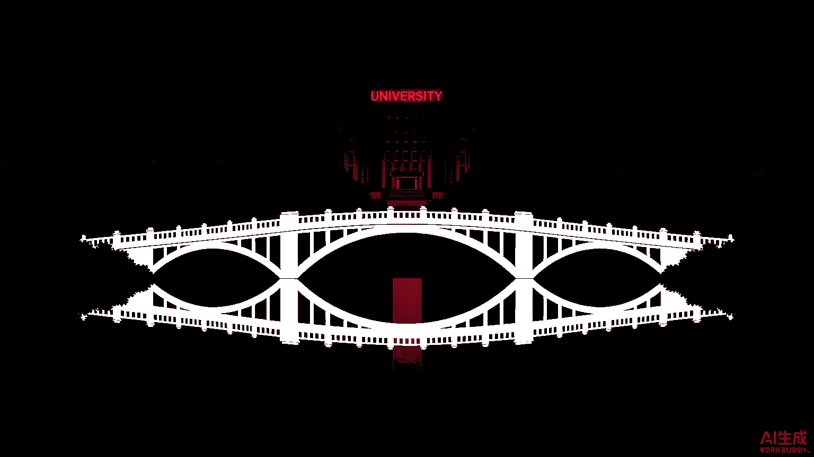
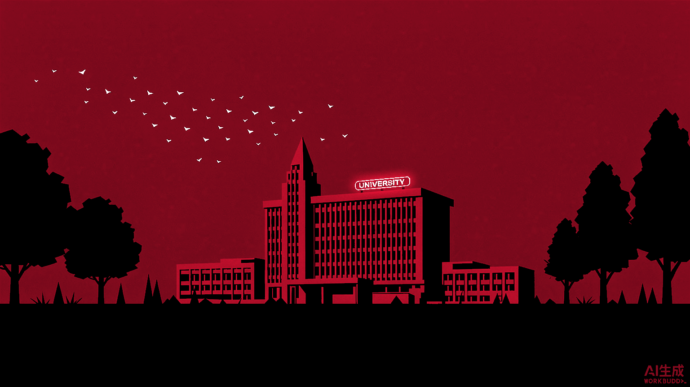
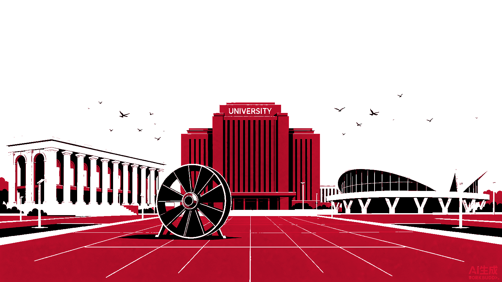

# ppt-xqmsav-skill

> 制作 **AI「一镜到底」变形转场视频** 的技能包 —— 多个地标场景在连续镜头中依次变形衔接（A 场景的某元素化作 B 场景的某元素），结尾回到起点形成闭环，配以统一的高对比配色。成品用于 **PPT 震撼开场**、城市宣传短片、账号爆款视频。

从一段「赛走熊猫PPT」教程视频逆向拆解而来，已在杭州地标、华北电力大学北京校区两个真实项目上跑通全流程。

## 效果长什么样

一次完整闭环，四个关键帧（华北电力大学北京校区案例）：

| 起点 / 闭环落点 | 开场红天空 |
|---|---|
|  |  |

| 白天全景 | 垂直俯拍骨架 |
|---|---|
|  |  |

成片：`红色天空飞鸟 → 飞鸟落点化为楼群 → 拱门俯冲穿入转子 → 叶片翻卷成膜骨架 → 垂直俯拍道路化水面 → 拱桥升起 → 桥板化作飞鸟 → 回到起点`

## 五步法

1. **设计场景链** — 同城 4~6 个地标排成环形，起点即终点；相邻两场景必须存在能互相变形的相似元素
2. **素材统一风格化** — 所有实拍照片转成同一风格（如红/白/黑扁平海报风），风格不统一必然穿帮
3. **设计匹配转场点（Match Cut）** — 为每对相邻场景指定「前元素 → 后元素 + 变形动词」
4. **分段生成** — 首尾帧接力（上段尾帧作下段首帧）或多图引用长提示词
5. **后期合成** — 裁角标、交叉淡化、加中英字幕、配乐

## 安装

把整个目录放进技能目录即可（WorkBuddy / Claude Code 兼容）：

```bash
git clone https://github.com/HaoyangZhang3/ppt-xqmsav-skill.git ~/.workbuddy/skills/ppt-xqmsav-skill
```

触发词：「一镜到底」「变形转场」「场景无缝 morph」「地标穿梭视频」「PPT 震撼开场视频」「AI 转场视频」，或直接点名 `ppt-xqmsav-skill`。

## 目录结构

```
ppt-xqmsav-skill/
├── SKILL.md                      # 五步工作流 + 交互要点 + 工具参数坑
├── references/
│   └── prompt-patterns.md        # 句式模板、变形动词库、镜头词库、完整案例提示词、失败对策
├── scripts/
│   ├── extract_frames.py         # 抽帧拼九宫格，检查转场衔接
│   ├── palette_unify.py          # 把一批图统一到红/白/黑三色，防跳色
│   └── assemble_video.py         # 裁角标 + 交叉淡化 + 中英字幕 + 输出 1280x720
└── assets/
    ├── case-hangzhou/            # 杭州案例四张风格化图
    └── case-ncepu/               # 华电北京校区案例四张风格化图
```

## 脚本用法

```bash
# 1. 统一配色（消除各图天空/地面色差）
python scripts/palette_unify.py gen/img1.png gen/u1.png

# 2. 抽帧检查转场衔接
python scripts/extract_frames.py final.mp4 chk/final 12

# 3. 合成成片（段顺序即播放顺序）
python scripts/assemble_video.py out.mp4 seg1.mp4 seg2.mp4 seg3.mp4 seg4.mp4
```

依赖：`opencv-python`、`Pillow`（中文字幕需要系统字体，默认取 `C:/Windows/Fonts/msyhbd.ttc`，其他系统请改 `FONT_CN`）。

## 实测踩坑（已写进 SKILL.md）

- 视频模型分辨率只吃 `768P` / `2K`，传 `1080p` 直接报错
- 视频模型**强制生成音轨**，传 `enable_audio: false` 会报错
- 生成视频的「AI生成」角标在**左上角**，而静帧在右下角 —— 合成时要分别裁上下边缘
- 同一提示词偶尔返回 `requires prompt` 错误，重试即可

## 案例

- **杭州**：雷峰塔 → 灵隐寺 → 杭州之门 / 莲花碗 → 张拉膜桥 → 回雷峰塔
- **华北电力大学北京校区**：主楼 → 大礼堂 → 汽轮发电机转子 → 六十周年雕塑骨架 → 校园水系拱桥 → 回主楼

## License

MIT
